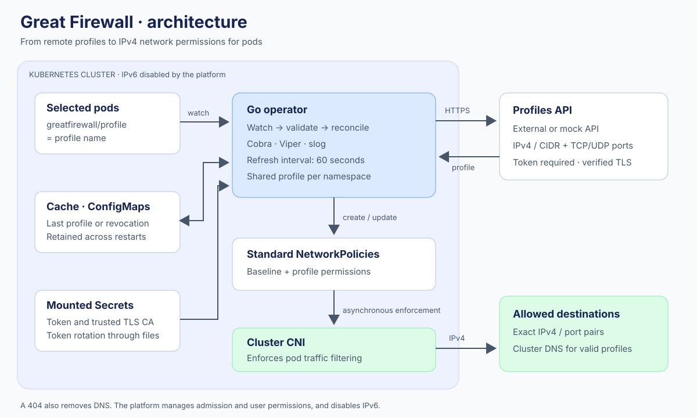
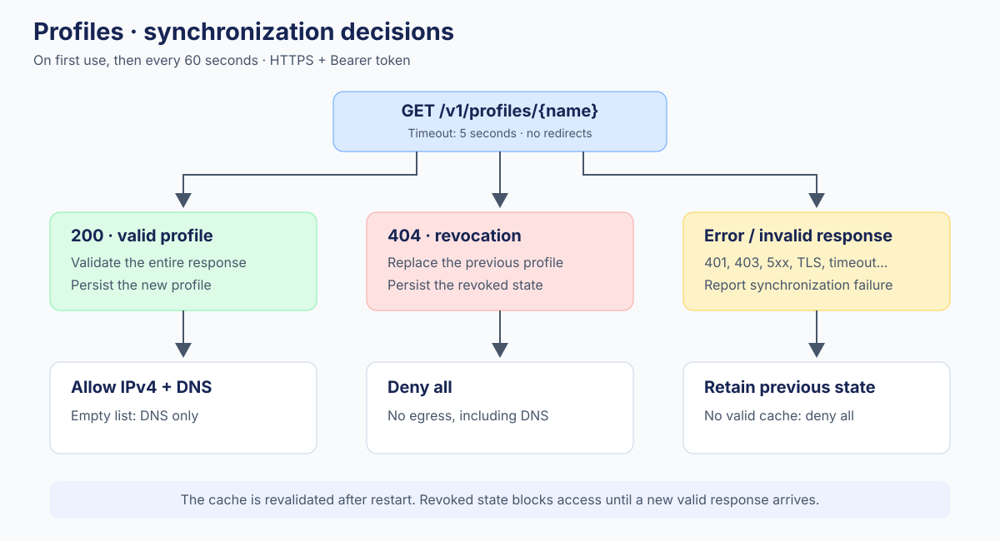

# Architecture

## Responsibilities

The operator watches namespaces, pods, and NetworkPolicies. Each pod or policy event triggers reconciliation of its namespace. Periodic reconciliation also refreshes profiles without requiring a Kubernetes event.

1. Check that the namespace exists and skip namespaces being deleted.
2. Create or repair the deny policy selecting labelled pods.
3. Group pods by profile and detect unsupported network configurations.
4. Retrieve each profile through the shared cache and HTTPS client.
5. Update one authorization policy per profile in the namespace.
6. Remove unused policies and report overlapping third-party policies.

Each profile policy is updated in place. Every permission preserves the exact association between destination, protocol, and port. DNS is added to the same object, so revocation cannot leave a separate DNS policy active.

## Profile state

The cache uses one ConfigMap per profile in the operator's namespace. Each ConfigMap contains either a validated profile or an explicit revocation, together with its observation time. Object names are derived from SHA-256; the original identity and ownership markers are also checked before each write.

Requests are shared across namespaces. Invalid profiles are never applied partially. HTTP errors other than 404, TLS errors, and malformed responses retain the last known state. The cache is revalidated on startup, including checks that reject IPv6.

State persistence is attempted before policies are updated. If a Kubernetes write fails, the error is reported and persistence is retried. A Kubernetes API outage can delay revocation; the operator cannot change network enforcement while the control plane is unavailable.

## Go structure

A single Go module avoids separate versioning for components released together. Responsibilities are separated into internal packages:

| Package | Responsibility |
|---|---|
| `cmd/operator`, `cmd/mock-api` | Minimal entry points |
| `internal/cli` | Cobra commands and slog initialization |
| `internal/config` | Strict YAML, defaults, and Viper environment bindings |
| `internal/profile` | Domain contract, normalization, and IPv4 validation |
| `internal/api` | HTTPS client, tokens, and mock API handlers |
| `internal/cache` | Shared refreshes and persistent snapshots |
| `internal/policy` | Compilation of profiles and DNS exceptions |
| `internal/controller` | Reconciliation, ownership, cleanup, and events |
| `internal/operator` | Manager and metrics setup |
| `internal/mockserver` | TLS server and graceful shutdown |
| `internal/identity` | Stable names and resource markers |
| `internal/quality` | Documentation and coverage checks |

The external API remains the source of permissions. The product requires no database, CRD, admission webhook, or Calico-specific resource. Calico is used by the network test environment.
