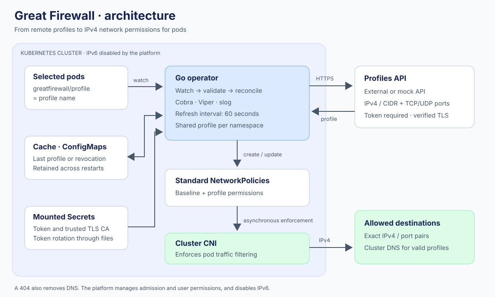

# Great Firewall Operator

A Kubernetes operator that turns remote network profiles into **IPv4 egress permissions**. Pods select a profile through the `greatfirewall/profile` label. Pods using the same profile within a namespace share their rules.



## How it works

- Deny egress for selected pods, then allow the profile's IPv4 address/port pairs.
- Allow cluster DNS only for valid profiles, over TCP and UDP port 53.
- Require HTTPS and a Bearer token, with Secrets mounted as files and token rotation without restarts.
- Refresh every 60 seconds with a 5-second HTTP timeout; both settings are configurable.
- Persist state in Kubernetes: an outage retains the last known state; a **404 removes all permissions, including DNS**.
- Reject IPv6 in profiles and configuration. The platform must disable IPv6 for workloads.

The project uses **Go, controller-runtime, Cobra, Viper, and slog**. It includes the operator, a mock API, Docker images, a Helm chart, and network tests.

## Quick start

Prerequisites: Go 1.25 or later, Helm 3, kubectl, and an IPv4 cluster with a CNI that enforces NetworkPolicies. The cluster must be able to access the images.

```sh
make build
make images

# Explicitly select the demo cluster before running these commands.
bash scripts/demo-secrets.sh greatfirewall-system gfw
helm install gfw charts/greatfirewall \
  --namespace greatfirewall-system \
  --values examples/values-demo.yaml
```

For Kind, load local images with `kind load docker-image`. Alternatively, publish them to your registry and reference them in the Helm values. The example IP addresses belong to a documentation range; replace them with test destinations.

In a prepared namespace, wait for `greatfirewall-deny-egress` before creating the pod:

```sh
kubectl -n my-namespace wait --for=create \
  networkpolicy/greatfirewall-deny-egress --timeout=60s
kubectl -n my-namespace apply -f examples/pod.yaml
```

A policy's presence in the Kubernetes API does not prove that the CNI has already applied it. Review the [security requirements](docs/security.md) before deploying untrusted workloads.

## Documentation

| Document | Contents |
|---|---|
| [Architecture](docs/architecture.md) | Components, Go packages, and reconciliation lifecycle |
| [Installation](docs/installation.md) | Helm, external API, demo, and uninstallation |
| [Configuration](docs/configuration.md) | Cobra, Viper, DNS, intervals, and Secrets |
| [API](docs/api.md) | Contract, responses, and mock server |
| [Security](docs/security.md) | IPv4, TLS, tokens, revocation, and Kubernetes limitations |
| [Operations](docs/operations.md) | slog output, metrics, rotation, and troubleshooting |
| [Development](docs/development.md) | Structure, conventions, documentation, and tests |
| [Validation](docs/validation.md) | Executed checks and verification scope |
| [OpenAPI](docs/openapi.yaml) | Machine-readable API contract |

## Verification

```sh
make verify
make e2e
```

`make verify` checks formatting, documentation for every function, `go vet`, tests with the race detector, global coverage **≥ 90%**, and the Helm chart. It generates the HTML report at `reports/coverage.html`.

`make e2e` builds the images and creates a disposable Kind cluster with Calico. It uses its own kubeconfig, checks real connections, then deletes the cluster. Diagnostic logs remain in `reports/`.
